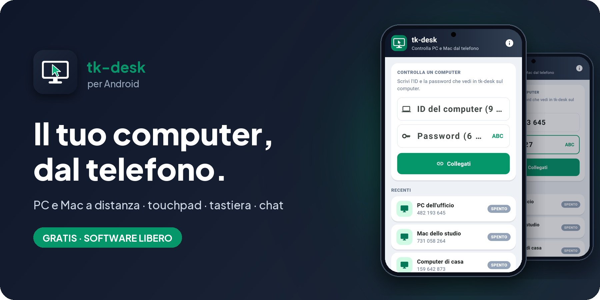
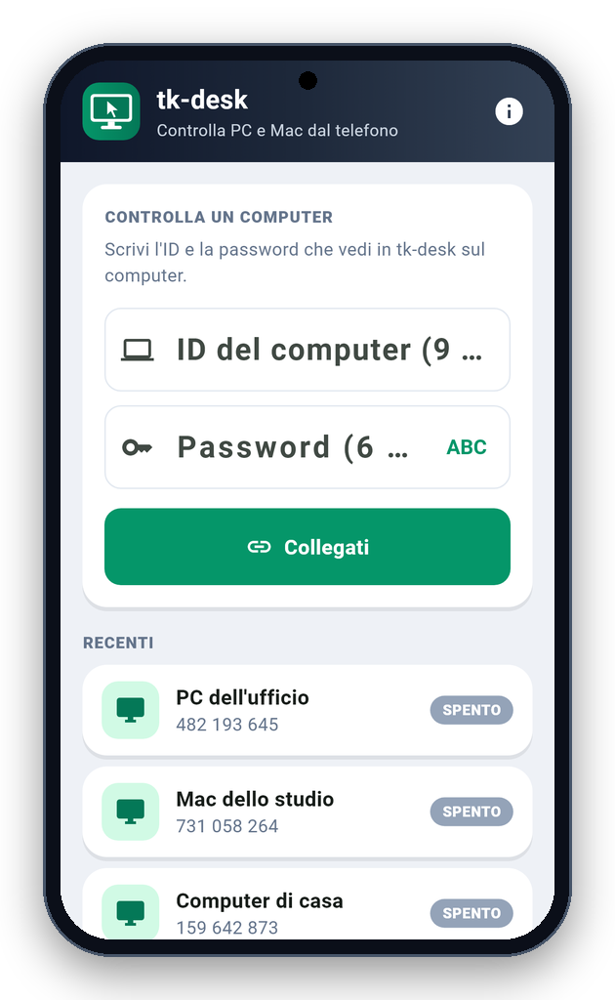
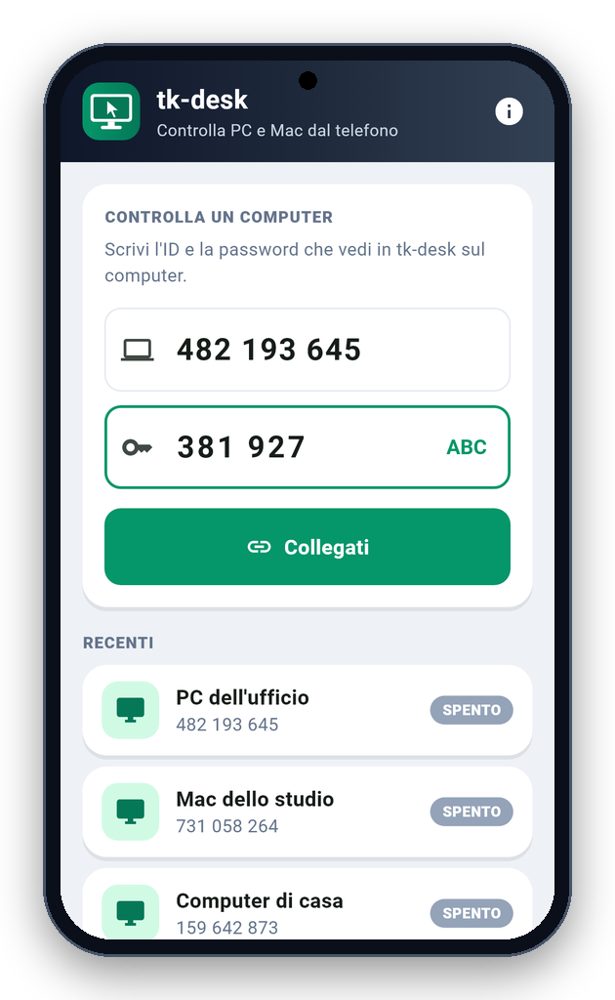

<!-- README generato da Dropbox/CLAUDE/dev/agpl-rollout/readme/genera_readme_app.py: modificare lì -->
<div align="center">



<br><br>

<a href="https://pietrodefilippis.it/scarica-app/tk-desk-app/"></a> &nbsp; <a href="https://pietrodefilippis.it/donazione/"></a>

<br><br>

<a href="COPYING"></a>   

</div>

> [!WARNING]
> **Contro le truffe:** non dare mai ID e password a chi ti chiama o ti scrive dicendo di essere un tecnico, la banca o la polizia. Usa tk-desk solo con persone che conosci.

---

## ✨ Cosa fa

<table>
<tr>
<td width="50%" valign="top">

### 🖱️&nbsp; Touchpad o tocco diretto
Muovi il puntatore come su un touchpad o tocca dove vuoi cliccare; due dita per zoom e scorrimento.

</td>
<td width="50%" valign="top">

### ⌨️&nbsp; Tastiera completa
La tastiera del telefono scrive sul computer, con Esc, Tab, Ctrl e le frecce.

</td>
</tr>
<tr>
<td width="50%" valign="top">

### 🖥️&nbsp; Più schermi
Scegli quale schermo del computer vedere.

</td>
<td width="50%" valign="top">

### 💬&nbsp; Chat e incolla
Scrivi a chi è al computer e incolla quello che hai copiato sul telefono.

</td>
</tr>
<tr>
<td width="50%" valign="top">

### 🏢&nbsp; Accesso non presidiato
Password fissa per i tuoi computer. Gratis anche questo.

</td>
<td width="50%" valign="top">

### 🔐&nbsp; Cifrato
Schermo e comandi passano cifrati: il server che mette in contatto i due non li vede.

</td>
</tr>
</table>

## 📱 Com'è fatta

<div align="center">

<table align="center">
<tr>
<td align="center" valign="top"><br><sub><b>Home</b></sub></td>
<td align="center" valign="top"><br><sub><b>Collegamento</b></sub></td>
</tr>
</table>

</div>

## 🔒 I tuoi dati

- **Privacy:** i computer recenti restano sul telefono. Per collegarsi il telefono usa il centralino di pietrodefilippis.it (ID e nome del telefono, messaggi firmati), i server STUN di Google e, se il collegamento diretto non riesce, un ponte TURN di Cloudflare; schermo e comandi passano cifrati e il centralino non li vede. Le statistiche anonime (una volta al giorno: nome, versione, sistema e un codice casuale) partono solo se dici sì nel benvenuto o in Informazioni.

Nessuna pubblicità, nessun account da creare, nessun abbonamento: tutte le funzioni sono gratis, per tutti.

## 📥 Installazione

- **Android** — [scarica l'app](https://pietrodefilippis.it/scarica-app/tk-desk-app/) da pietrodefilippis.it e aprila: Android chiede una volta il permesso di installare app da questa origine. Gli aggiornamenti arrivano da soli, l'app te li propone. A breve anche su Google Play.
- **Piattaforme:** Android; iPhone in arrivo. Sul computer serve tk-desk per Windows o Mac: [tk-desk per computer](https://pietrodefilippis.it/software/).

<details>
<summary><b>🛠️ Compilare dal codice sorgente</b></summary>

<br>

Serve [Flutter](https://flutter.dev) (versione indicata in `.github/workflows/android.yml`):

```bash
flutter pub get
flutter test
flutter build apk --release
```

Senza la variabile `ANDROID_KEYSTORE` l'APK si firma con la chiave di debug di Flutter.

</details>

## 📜 Licenza

**tk-desk** è software libero: © 2026 Pietro De Filippis (TecnikGeek), licenza
**[GNU Affero General Public License v3.0](COPYING)**. Puoi usarlo, studiarlo, modificarlo e condividerlo; è
fornito **così com'è, senza alcuna garanzia**.

> Il nome **tk-desk** e il logo non sono coperti dalla licenza (AGPL, sezione 7): una versione modificata deve avere un nome diverso.

---

<div align="center">

**Ti è utile?** Tutte le funzioni sono gratis per tutti. Se vuoi, un caffè aiuta a migliorarla e a crearne altre.

<a href="https://pietrodefilippis.it/donazione/"></a>

<sub>Creata da <a href="https://pietrodefilippis.it">Pietro De Filippis · TecnikGeek</a> — Webmaster & UX/UI Designer</sub>

</div>
